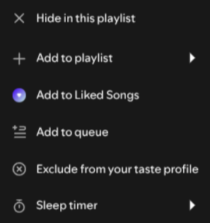

## Less annoying hide button for spicetify

If you ever tried to queue the current song again as it's about to end when you're still jamming out and had this dumb hide button pop up _in the exact location_ of the queue button, I feel your pain. So much so, that I had to make this simple extension to fix that behavior.

  

This extension pins the lazy loading "Hide in this playlist" menu option appear at the top of the context menu, preventing accidentally clicking that instead of queue. 
